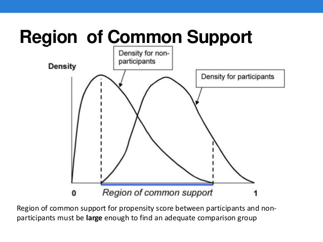

```{r xaringan-css, echo=FALSE, results='asis'}
# Writes the small style file the deck needs (logo + font sizes). Put uofl.png next to this Rmd.
writeLines(c(
  ".remark-slide-content { font-size: 22px; padding: 0.8em 2em; background-image: url(uofl.png); background-repeat: no-repeat; background-position: 97% 3%; background-size: 90px; }",
  ".remark-slide-content h1 { font-size: 1.6em; }",
  ".smaller { font-size: 18px; }",
  ".smaller .remark-code, .smaller code { font-size: 75%; }",
  ".remark-code, .remark-inline-code { font-size: 80%; }"
), "custom.css")
```

<script type="text/javascript" async src="https://cdn.jsdelivr.net/npm/mathjax@2.7.9/MathJax.js?config=TeX-MML-AM_CHTML"></script>

---

# Propensity Score Match

Propensity Score Matching (PSM) is a useful technique when using quasi-experimental or observational data (Austin, 2011; Rosenbaum & Rubin, 1983).

  * It helps to create a counterfactual sample (control group) when random assignment is unavailable, unfeasible, or unethical. 
  * By matching on one index (the propensity score) instead of on every covariate, PSM mitigates the curse of dimensionality associated with "exact match" techniques.
  * It is still data hungry: you need enough treated and control units with overlapping covariates. Matching does not rescue a sample with no common support.

---

# The causal question: potential outcomes

Each unit $i$ has two potential outcomes: $Y_i(1)$ if treated and $Y_i(0)$ if not. We only see one of them.

$$Y_i = Z_i Y_i(1) + (1-Z_i) Y_i(0)$$

Two estimands we will use all lecture:

* __ATE__: $E[Y(1)-Y(0)]$, the effect for a randomly chosen unit.
* __ATT__: $E[Y(1)-Y(0) \mid Z=1]$, the effect for the units that actually got treated.

Matching treated units to controls usually targets the __ATT__: the controls are used to estimate $E[Y(0) \mid Z=1]$.

---

# What PSM needs: two assumptions

1. __Unconfoundedness__ (selection on observables): given the covariates $X$, treatment is as good as random. $$(Y(1),Y(0)) \perp Z \mid X$$
2. __Overlap__ (common support): every kind of unit could be treated or untreated. $$0 < Pr(Z=1 \mid X) < 1$$

Rosenbaum and Rubin (1983) show that if (1) holds given $X$, it also holds given the propensity score $e(X)=Pr(Z=1 \mid X)$.

__Matching cannot fix unobserved confounders.__ If something that drives both $Z$ and $Y$ is not in $X$, matching is still biased.

---

# Where matching fits

The linear model $$y=z \gamma+X\beta+u$$ gives an unbiased estimate of $\gamma$ if $E[Zu]=0$ (treatment is exogenous).

In non-experimental settings that assumption often fails: treatment is endogenous ($E[Zu]\ne0$).

* If we have a valid instrument for $z$, we can use IV.
* If there is no instrument, but we believe we observe all the confounders (unconfoundedness above), then matching or weighting on the propensity score is an option.

Matching is a way to build a better comparison group, not a way to get around endogeneity from unobservables.

---

# Two steps

Step 1. Use a probit or logit model to estimate the propensity score $e(X)=Pr(z=1|X)$.

  - This step estimates the likelihood that a person would receive treatment given their observable characteristics.

Step 2. Use the estimated propensity score to match people in the treatment group with people in the control group that have very similar scores.

  - For example, if someone in the treatment group has a predicted probability of receiving treatment equal to 0.5, then we would like to match that person with someone who has a predicted probability close to 0.5, but who did not receive the treatment.

Step 3 (do not skip). __Check balance__ on the matched sample. Only then look at the outcome.

---

# PSM illustrated

```{r echo=FALSE, fig.align='center', out.width="75%"}

```

---

# PSM Tips

* Logit may not be the best way to construct the propensity score. Add interactions and squared terms if balance is poor.

* Machine learning is well suited to classification problems. Boosted trees (GBM) or other classifiers can give better scores, but you must still check balance.

* The goal is balance on the covariates, not a well-fitting treatment model. Do not judge the score model by its p-values or pseudo-R2.

---

# Examples of Propensity Score problems

* Job Corps is the largest free residential education and job training program in the US. We may want to know the benefit of Job Corps on employment. However, individuals self-select into the program.

* Is there a wage penalty associated with smoking? People are not randomly assigned to be smokers. How can we estimate this effect?

* Is there a benefit of attending private vs public school? Students are not randomly assigned to public or private schools.

* A business example: does joining a loyalty program raise customer spending? Customers choose to join. (We simulate this one later.)

---

# Other types of matching

Before we proceed with propensity score matching let's consider two alternatives

1. Exact Match: Here we match people in the treatment group with individuals in the control group that have identical observable characteristics (i.e. X's).

  * This method requires a lot of data.
  * The assumption is that the unobserved portion of the individual is randomly distributed.
  * We can average the outcome variable of the set of exact control matches and subtract that from the treatment outcome. The Law of Large numbers will give us an unbiased estimate as $n \to \infty$.
  
---

# Other types of matching

Before we proceed with propensity score matching let's consider two alternatives

2. Mahalanobis Metric Matching: Relaxes the assumption of _exact match_. Instead, it calculates the distance between observation using a multidimensional distance metric.

  * Requires less data than exact match.
  * suffers from the curse of dimensionality.
  * To reduce the curse of dimensionality remove X's that are more randomly distributed between groups.
  
---

# Mahalanobis Metric Matching

The distance formula is given by $$d(i,j)=(u-v) C^{-1} (u-v)^T$$

Let k be the number of covariates, then u is a row vector of covariate for person i (treatment) with the dimensions 1xk. Similarly, v is a row vector for person j (control). The matrix $C^{-1}$ is the covariance matrix for the control group.

We match every person in the treatment with a person in the control group that has the smallest $d(i,j)$

It is possible that an individual from the control group who is selected as the match for a participant in the treatment group, is not close in a multidimensional space. The average distance between observations actually increases as we included more covariates (Gu & Rosenbaum, 1993; Stuart, 2010; Zhao, 2004).

---

# Propensity Score Matching

In propensity score matching, we utilize the nearest-neighbor routine, which matches individuals in the treatment group with individuals in the control group who have the closest propensity score.

As with the Mahalanobis metric, we need to make sure the distance between matches is not too great. We can impose a _caliper_, which states that $$|\ell_i-\ell_j|<\epsilon$$

where $\ell$ is the logit of the propensity score and $\epsilon=0.2\,\sigma_\ell$, with $\sigma_\ell$ the standard deviation of the logit of the propensity score (Austin, 2011). Treated units with no control inside the caliper are dropped, so the estimand becomes the ATT for the matched treated units.

---

# Advanced Routines

1. You can combine PSM with Mahalanobis Metric by estimating the propensity scores and including the score as another covariate in the Mahalanobis Metric

2. Optimal Matching: This method uses propensity score matching, but tries to minimize the total propensity score difference across all matches.

3. Full Matching: Forms subclasses that each contain one treated unit and one or more controls (or one control and several treated units). Every unit is used, usually without replacement, and units are weighted within subclasses. This keeps all of the data and often gives the best balance.

4. Matching _with replacement_ is a separate choice: the same control can be used for more than one treated unit. It can improve balance, but you must account for the repeated use of controls in the standard errors.

---

# Which Routine should I choose?

There are many choices and approaches to matching, including:

- Propensity score matching.
- Limited exact matching.
- Full matching.
- Nearest neighbor matching.
- Optimal/Genetic matching.
- Mahalanobis distance matching (for quantitative covariates only).
- Matching with and without replacement.
- One-to-one or one-to-many matching.

Which matching method should you use? __Whichever one gives the best balance!__ Judge balance with standardized mean differences, not with p-values, and decide on the matching method before you look at the outcome.

---
class: inverse, center, middle

# Propensity Match in R

---

# National Supported Work

The National Supported Work (NSW) Demonstration was a federally and privately funded randomized experiment done in the 1970s to estimate the effects of a job training program for disadvantaged workers.

Participants were randomly selected to participate in the training program. Both groups were followed up to determine the effect of the training on wages.

Analysis of the mean differences (unbiased given randomization), was approximately $800.

[LaLonde (1986)](https://www.jstor.org/stable/1806062?seq=1) used data from the Panel Survey of Income Dynamics (PSID) and the Current Population Survey (CPS) to investigate whether non-experimental methods would result in similar results to the randomized experiment. He found results ranging from $\$$ 700 to $\$$ 1,600. He concluded that non-experimental methods, as used then, do not reliably reproduce the experimental results.

---

# PSM: Dehejia and Wahba (1999)

[Dehejia and Wahba (1999)](https://www.jstor.org/stable/2669919) later used propensity score matching to analyze the data. They criticized the comparison groups used by LaLonde (1986) and found evidence in support of propensity score matching.

- Comparison groups selected by LaLonde were very dissimilar to the treated group.
- By restricting the comparison group to those that were similar to the treated group, they could replicate the original NSW results.
- Using the CPS data, the range of treatment effect was between $1,559 to $1,681. The experimental results for the sample was approximately $1,800.
- The covariates available include: age, education level, high school degree, marital status, race, ethnicity, and earnings in 1974 and 1975.
- Outcome of interest is earnings in 1978.

---
class: smaller

# Setup

```{r setup, message=FALSE, warning=FALSE}
library(MatchIt)      # matching
library(cobalt)       # balance tables and plots
library(marginaleffects) # effect estimates with weights and cluster SEs
library(sandwich); library(lmtest)  # robust standard errors
data(lalonde)         # the lalonde data set shipped with MatchIt
table(lalonde$treat)
```

The treated group is the NSW job training sample. The control group comes from the PSID, a survey of the general population, so the groups differ a lot at the start.

---
class: smaller

# Calculating the Propensity Score

```{r message=FALSE, warning=FALSE, results='asis'}
lalonde.formu <- treat ~ age + educ + race + married + nodegree + re74 + re75
ps <- glm(lalonde.formu, family=binomial, data=lalonde)
stargazer::stargazer(ps,type="html",single.row = TRUE)
```

---
class: smaller

# Balance before matching

```{r message=FALSE, warning=FALSE}
m.none <- matchit(lalonde.formu, data = lalonde, method = NULL, distance = "glm")
bal.tab(m.none, un = TRUE, stats = c("m", "ks"), thresholds = c(m = .1))
```

A standardized mean difference above about 0.1 in absolute value is a common warning sign.

---

# Overlap before matching

```{r message=FALSE, warning=FALSE}
bal.plot(m.none, var.name = "distance", which = "unadjusted", type = "histogram", mirror = TRUE)
```

---
class: smaller

# Nearest neighbor matching with a caliper

```{r message=FALSE, warning=FALSE}
m.nn <- matchit(lalonde.formu, data = lalonde, method = "nearest",
                distance = "glm", link = "linear.logit",
                ratio = 1, caliper = 0.2)
m.nn
nn.match <- match.data(m.nn)
```

We match on the logit of the propensity score (`link = "linear.logit"`) and use a caliper of 0.2 standard deviations of that score. `match.data()` returns the matched sample with `weights` and `subclass` columns.

---
class: smaller

# Balance after matching

```{r message=FALSE, warning=FALSE}
bal.tab(m.nn, un = TRUE, stats = c("m", "ks"), thresholds = c(m = .1))
```

---

# Love plot

```{r message=FALSE, warning=FALSE, fig.height=4.5}
love.plot(m.nn, binary = "std", thresholds = c(m = .1), abs = TRUE)
```

---

# Overlapping propensity scores after matching

```{r message=FALSE, warning=FALSE}
bal.plot(m.nn, var.name = "distance", which = "both", type = "histogram", mirror = TRUE)
```

---
class: smaller

# Replication: Results

```{r message=FALSE, warning=FALSE}
covs <- ~ age + educ + race + married + nodegree + re74 + re75

# 1. OLS on the full sample, robust SEs
fit.ols <- lm(update(covs, re78 ~ treat + .), data = lalonde)

# 2. Matched sample: regression adjustment, SEs clustered on matched pairs
fit.nn <- lm(update(covs, re78 ~ treat * (.)), data = nn.match, weights = weights)
est.nn <- avg_comparisons(fit.nn, variables = "treat",
                          vcov = ~subclass,
                          newdata = subset(nn.match, treat == 1),
                          wts = "weights")

# 3. Matched sample: simple difference in means
fit.nn.diff <- lm(re78 ~ treat, data = nn.match, weights = weights)
```

---
class: smaller

# Replication: helper functions

```{r message=FALSE, warning=FALSE}
rob <- function(fit) {
  ct <- coeftest(fit, vcov. = vcovHC(fit, type = "HC1"))
  c(Estimate = unname(ct["treat", 1]), SE = unname(ct["treat", 2]))
}

# SEs clustered on matched pairs (use after pair matching)
rob.cl <- function(fit, cluster) {
  ct <- coeftest(fit, vcov. = sandwich::vcovCL(fit, cluster = cluster, type = "HC1"))
  c(Estimate = unname(ct["treat", 1]), SE = unname(ct["treat", 2]))
}

# Treated units dropped by the caliper
n.drop <- sum(m.nn$weights[m.nn$treat == 1] == 0)
```

---
class: smaller

# Replication: Results

```{r message=FALSE, warning=FALSE}
res <- rbind(
  "OLS, full sample"            = rob(fit.ols),
  "Matched, diff. in means"     = rob.cl(fit.nn.diff, nn.match$subclass),
  "Matched + regression (retained treated)"  = c(est.nn$estimate, est.nn$std.error)
)
res <- data.frame(res, t = res[, 1] / res[, 2])
knitr::kable(round(res, 1), caption = "Effect of NSW training on 1978 earnings ($)")
```

The matched rows use standard errors clustered on matched pairs. The matched estimates are effects for the treated units that kept a match (`r n.drop` treated units were dropped by the caliper), so they are not strictly the full-sample ATT.

Compare these to the experimental benchmark of roughly $1,800 (Dehejia and Wahba, 1999).

---

# What else can we do with propensity scores?

Suppose you do not like the idea of throwing out data as we do with matching.

An alternative is __inverse probability weighting__ (IPW): a weighted regression where the weights come from the propensity score.

For the __ATE__ the weights are

* treated: $\frac{1}{e(X)}$
* controls: $\frac{1}{1-e(X)}$

For the __ATT__ (the full treated group; our caliper match targets the retained treated units, so it is close but not identical) the weights are

* treated: $1$
* controls: $\frac{e(X)}{1-e(X)}$

Matching, ATT weights and ATE weights answer different questions. Compare like with like.

---
class: smaller

# Propensity score weights in R

```{r message=FALSE, warning=FALSE}
lalonde$ps <- predict(ps, type = "response")
lalonde$w_ate <- ifelse(lalonde$treat == 1, 1/lalonde$ps, 1/(1 - lalonde$ps))
lalonde$w_att <- ifelse(lalonde$treat == 1, 1, lalonde$ps/(1 - lalonde$ps))

fit.ate <- lm(update(covs, re78 ~ treat + .), data = lalonde, weights = w_ate)
fit.att <- lm(update(covs, re78 ~ treat + .), data = lalonde, weights = w_att)

res2 <- rbind(res[, 1:2],
              "IPW, ATE weights" = rob(fit.ate),
              "IPW, ATT weights" = rob(fit.att))
res2 <- data.frame(res2, t = res2[, 1] / res2[, 2])
knitr::kable(round(res2, 1))
```

Robust (HC1) standard errors. The weights are estimated, so these SEs are approximate; a bootstrap or a package such as WeightIt handles that properly.

---
class: smaller

# Did the weights balance the data?

```{r message=FALSE, warning=FALSE}
bal.tab(lalonde.formu, data = lalonde, weights = lalonde$w_att, estimand = "ATT",
        un = TRUE, thresholds = c(m = .1))
```

Always check balance for weighting too. Very large weights (extreme propensity scores) are a sign of poor overlap.

---
class: smaller

# LaLonde as a lesson: why is it so hard?

The estimates are noisy and not precisely centered on the experimental answer. That is the point of the data set.

* The PSID controls look very different from the NSW trainees (low earnings, many unemployed in 1974-75). Overlap is thin, so a caliper drops treated units and the sample shrinks.
* We only match on a handful of covariates. Pre-treatment earnings are a crude proxy for motivation and labor market history. Unconfoundedness is a strong assumption here.
* With about 185 treated units, the standard errors are large relative to an effect of roughly $1,800.
* Different, reasonable analyst choices (formula, caliper, estimand) move the estimate a lot. Report the choices you made before you saw the results.

__Takeaway:__ a non-significant matched estimate is not a failure of the code. It tells you how much the data can support.

---

# Sensitivity analysis: how wrong could we be?

Matching assumes no unobserved confounding. We can ask how strong an unmeasured confounder would have to be to explain away the result.

* __Rosenbaum bounds__: how large a hidden bias (odds of treatment differing between matched units) would overturn a significant finding? (`rbounds` package, for matched pairs.)
* __E-value__ (VanderWeele and Ding, 2017): the minimum strength of association an unmeasured confounder needs with both treatment and outcome to fully explain the observed effect. (`EValue` package.)

```{r eval=FALSE}
# standardized mean difference as the input (not run in the slides)
d <- est.nn$estimate / sd(nn.match$re78)
EValue::evalues.MD(est = d, se = est.nn$std.error / sd(nn.match$re78))
```

A result that is robust only to tiny hidden bias should be presented with care.

---
class: inverse, center, middle

# A simulated business example

---
class: smaller

# Does a loyalty program raise spending?

We simulate customers where we know the true effect, so we can see whether each method recovers it.

* Customers choose to join the loyalty program. Joining is more likely for customers who already spend a lot, have a long tenure, and open our emails.
* Those same traits also raise future spending. So a simple comparison of members and non-members is biased upward.
* True effect of the program in the simulation: __+$40__ per customer.

---
class: smaller

# Simulating the loyalty data

```{r message=FALSE, warning=FALSE}
set.seed(2026)
n <- 5000
sim <- data.frame(
  age        = round(pmin(pmax(rnorm(n, 42, 12), 18), 80)),
  tenure     = rgamma(n, shape = 2, scale = 1.5),      # years as a customer
  past_spend = exp(rnorm(n, 5, 0.6)),                 # prior-year spend ($)
  email_open = rbeta(n, 2, 3)                          # share of emails opened
)
sim$log_past <- log(sim$past_spend)
```

---
class: smaller

# Simulating the loyalty data (continued)

```{r message=FALSE, warning=FALSE}
p_join <- plogis(-0.7 + 0.9*(sim$log_past - 5) + 0.25*(sim$tenure - 3) +
                 1.5*(sim$email_open - 0.4))
sim$loyalty <- rbinom(n, 1, p_join)
tau <- 40
sim$spend <- 100 + 45*sim$log_past + 8*sim$tenure + 60*sim$email_open +
             0.5*sim$age + tau*sim$loyalty + rnorm(n, 0, 40)
table(sim$loyalty)
```

---
class: smaller

# Naive comparison vs the truth

```{r message=FALSE, warning=FALSE}
naive <- lm(spend ~ loyalty, data = sim)
coef(summary(naive))["loyalty", 1:2]
```

The naive estimate is higher than the true +$40 because members were already bigger spenders.

---
class: smaller

# Match, check balance, estimate

```{r message=FALSE, warning=FALSE}
sim.formu <- loyalty ~ age + tenure + log_past + email_open
m.sim <- matchit(sim.formu, data = sim, method = "nearest",
                 distance = "glm", link = "linear.logit", caliper = 0.2)
m.sim
love.plot(m.sim, binary = "std", thresholds = c(m = .1), abs = TRUE)
```

---
class: smaller

# Matched estimate vs the truth

```{r message=FALSE, warning=FALSE}
md.sim  <- match.data(m.sim)
fit.sim <- lm(spend ~ loyalty * (age + tenure + log_past + email_open),
              data = md.sim, weights = weights)
avg_comparisons(fit.sim, variables = "loyalty", vcov = ~subclass,
                newdata = subset(md.sim, loyalty == 1), wts = "weights")
```

Here unconfoundedness holds by construction (we generated everything from the covariates we match on) and overlap is good. That is why matching works well here and struggled with LaLonde.

__Exercise:__ drop `log_past` from `sim.formu`, or add an unobserved driver of both joining and spending to the simulation, and see what happens to the estimate.

---

# Criticism: should we use PSM at all?

King and Nielsen (2019) argue that matching on the propensity score can _increase_ imbalance, model dependence and bias as you prune more data, because it approximates a randomized experiment rather than a blocked one.

* Their advice: prefer other distance measures (Mahalanobis, coarsened exact matching) or other methods when you can.
* Others reply that PSM with good diagnostics is still useful, and that weighting or full matching avoids some of the problems.
* The message for practice: do not use PSM as a black box. Try several methods and compare balance and sensitivity.

---

# Summary

* Matching and weighting are useful when treatment is not randomized, you believe you observe the confounders (__unconfoundedness__), and there is __overlap__.
* The propensity score is a way to reduce many covariates to one number. It does not remove unobserved confounding.
* Always __check balance__ (standardized differences, love plot) before looking at outcomes.
* Be explicit about the estimand (ATT or ATE) and use standard errors that account for matching and weighting.
* Run a sensitivity analysis and try more than one method.
* There is a tradeoff between balance and sample size.

Extensions

* Inverse propensity score weights can also be used to adjust for sample selection bias.
* Doubly robust estimators combine an outcome model with the propensity score model.

---

# References

* Austin, P. C. (2011). An introduction to propensity score methods for reducing the effects of confounding in observational studies. _Multivariate Behavioral Research_, 46(3), 399-424.
* Dehejia, R. H., & Wahba, S. (1999). Causal effects in nonexperimental studies. _JASA_, 94(448), 1053-1062.
---

# References (continued)

* Greifer, N. MatchIt: Nonparametric Preprocessing for Parametric Causal Inference (R package documentation).
* King, G., & Nielsen, R. (2019). Why propensity scores should not be used for matching. _Political Analysis_, 27(4), 435-454.
* LaLonde, R. J. (1986). Evaluating the econometric evaluations of training programs with experimental data. _AER_, 76(4), 604-620.
* Rosenbaum, P. R., & Rubin, D. B. (1983). The central role of the propensity score in observational studies for causal effects. _Biometrika_, 70(1), 41-55.
* Stuart, E. A. (2010). Matching methods for causal inference: a review and a look forward. _Statistical Science_, 25(1), 1-21.
* VanderWeele, T. J., & Ding, P. (2017). Sensitivity analysis in observational research: introducing the E-value. _Annals of Internal Medicine_, 167(4), 268-274.
